# แผนภาพ ERD อ้างอิงทั้งหมด 19 ตาราง (YuemDee Database Schema)

```mermaid
erDiagram
    ADMIN {
        string id PK "รหัสผู้ดูแลระบบ"
        int auth_user_id FK, UK "บัญชี login ของ Django (superuser) → auth_user.id"
        string username UK "ชื่อบัญชี Django Admin (อ่านจาก auth_user · ไม่เก็บซ้ำ)"
        string name "ชื่อผู้ดูแลระบบ"
        string email "อีเมล (ไม่บังคับ @ubu)"
        datetime last_login "เข้าสู่ระบบล่าสุด (อ่านจาก auth_user · ไม่เก็บซ้ำ)"
        datetime created_at "วันที่สร้างบัญชี"
    }

    USER {
        string id PK "รหัสบัญชีผู้ใช้ UBU SSO (Supertype)"
        int auth_user_id FK, UK "บัญชี login ของ Django (nullable: ตั้ง Role Override ล่วงหน้าก่อน login ได้) → auth_user.id"
        string name "ชื่อ-นามสกุล"
        string email UK "อีเมล @ubu.ac.th"
        datetime first_login "เข้าสู่ระบบครั้งแรก"
        datetime last_login "เข้าสู่ระบบล่าสุด (อ่านจาก auth_user · ไม่เก็บซ้ำ)"
        datetime created_at "วันที่สร้างบัญชี"
        boolean blocked "สถานะระงับสิทธิ์"
        string block_reason "เหตุผลการระงับสิทธิ์"
        string blocked_by_staff FK "เจ้าหน้าที่ผู้สั่งระงับสิทธิ์ (nullable) → STAFF.user_id"
        string blocked_by_admin FK "แอดมินผู้สั่งระงับสิทธิ์ (nullable) → ADMIN.id"
    }

    STUDENT {
        string user_id PK, FK "รหัสบัญชีนักศึกษา → USER.id"
        string student_id UK "รหัสนักศึกษา 11 หลัก"
        string phone "เบอร์โทรศัพท์ 10 หลัก"
    }

    STAFF {
        string user_id PK, FK "รหัสบัญชีเจ้าหน้าที่ → USER.id"
        boolean is_override "true = ได้สิทธิ์จาก Role Override, false = บทบาทจาก UBU SSO"
        string override_reason "เหตุผลการกำหนดบทบาท (nullable)"
        string assigned_by FK "ผู้แต่งตั้งสิทธิ์ (nullable) → ADMIN.id"
        datetime assigned_at "วันที่แต่งตั้งสิทธิ์ (nullable)"
    }

    ITEM {
        int id PK "รหัสสิ่งของ (Supertype)"
        string item_type "ตัวแยกประเภท ISA: MATERIAL / DURABLE_MATERIAL / EQUIPMENT"
        string name "ชื่อสิ่งของ"
        string location "สถานที่ตั้งวางในคลัง"
        string unit "หน่วยนับ"
        decimal purchase_price "ราคาจัดซื้อ"
        string base_status "สถานะพื้นฐาน: AVAILABLE / DAMAGED / INACTIVE / RETIRED"
        string description "รายละเอียด"
        string image "รูปภาพ"
    }

    MATERIAL {
        int item_id PK, FK "รหัสวัสดุสิ้นเปลือง → ITEM.id"
        int qty_total "จำนวนทั้งหมด"
        int qty_available "จำนวนคงเหลือ"
    }

    DURABLE_MATERIAL {
        int item_id PK, FK "รหัสวัสดุคงทน → ITEM.id"
        int qty_total "จำนวนทั้งหมด"
        int qty_available "จำนวนคงเหลือ"
        int max_borrow_days "จำนวนวันยืมสูงสุด"
        decimal fine_rate_per_day "อัตราค่าปรับต่อวัน"
    }

    EQUIPMENT {
        int item_id PK, FK "รหัสครุภัณฑ์รายชิ้น → ITEM.id"
        string asset_tag UK "เลขครุภัณฑ์ประจำชิ้น เช่น UBU-EQ-001-01"
        int max_borrow_days "จำนวนวันยืมสูงสุด"
        decimal fine_rate_per_day "อัตราค่าปรับต่อวัน"
        string status "AVAILABLE / BORROWED / RETURN_PENDING / DAMAGED / MAINTENANCE / RETIRED / LOST"
        string note "หมายเหตุสภาพ/ความเสียหาย"
    }

    CART {
        int id PK "รหัสตะกร้า"
        string user_id FK, UK "เจ้าของตะกร้า (1 คน 1 ตะกร้า) → STUDENT.user_id"
        datetime created_at "วันที่สร้างตะกร้า"
        datetime updated_at "วันที่แก้ไขล่าสุด"
    }

    CART_ITEM {
        int id PK "รหัสรายการในตะกร้า"
        int cart_id FK "ตะกร้า → CART.id"
        int item_id FK "สิ่งของ → ITEM.id"
        int qty "จำนวนที่ต้องการ"
        datetime added_at "วันที่เพิ่มลงตะกร้า"
    }

    BORROW_REQUEST {
        int id PK "เลขที่ใบคำขอ"
        string user_id FK "ผู้ขอยืม → STUDENT.user_id"
        string approved_by FK "ผู้อนุมัติ → STAFF.user_id"
        date use_date "วันที่เริ่มใช้งาน"
        boolean is_special "ขอยืมกรณีพิเศษ"
        date custom_due_date "วันที่ขอคืนกรณีพิเศษ / วันที่เจ้าหน้าที่อนุมัติ (nullable)"
        string status "PENDING / BORROWING / RETURN_PENDING / ISSUED / RETURNED / REJECTED / CANCELLED / EXPIRED"
        datetime created_at "วันที่ส่งคำขอ"
        datetime approved_at "วันที่อนุมัติ"
        string reject_reason "เหตุผลที่ไม่อนุมัติ"
    }

    BORROW_ITEM {
        int id PK "รหัสรายการยืม"
        int borrow_request_id FK "ใบคำขอ → BORROW_REQUEST.id"
        int item_id FK "สิ่งของที่ยืม/เบิก → ITEM.id"
        int qty "จำนวนที่ยืม/เบิก"
        date due_date "วันครบกำหนดคืนรายชิ้น (nullable สำหรับวัสดุสิ้นเปลือง)"
        string initial_photo "รูปถ่ายสภาพของก่อนยืม"
        string current_location "ที่ตั้ง/ที่อยู่ปัจจุบันที่แจ้งย้าย"
        datetime moved_at "วันเวลาที่แจ้งย้ายล่าสุด"
    }

    RETURN_REQUEST {
        int id PK "รหัสใบแจ้งคืน"
        int borrow_request_id FK "ใบคำขอยืม → BORROW_REQUEST.id"
        string inspected_by FK "ผู้ตรวจรับคืน → STAFF.user_id"
        string status "RETURN_PENDING / RETURNED / REJECTED"
        string return_photo "รูปถ่ายหลักฐานการส่งคืน"
        decimal custom_fine "ยอดค่าปรับที่เรียกเก็บจริง (null = ใช้ SUM ของ RETURN_ITEM.fine)"
        boolean fine_paid "สถานะชำระค่าปรับ"
        string fine_reason "เหตุผลการปรับ/ลดหย่อน"
        string note "หมายเหตุการส่งคืน"
        datetime created_at "วันที่แจ้งคืน"
        datetime returned_at "วันที่ตรวจรับคืนสำเร็จ"
    }

    RETURN_ITEM {
        int id PK "รหัสรายการที่คืน"
        int return_request_id FK "ใบแจ้งคืน → RETURN_REQUEST.id"
        int borrow_item_id FK "รายการยืมเดิม → BORROW_ITEM.id"
        int qty_returned "จำนวนที่คืนในรอบนี้"
        string condition_status "NORMAL / DAMAGED / LOST"
        decimal fine "ค่าปรับเกินกำหนดของรายการนี้ (คำนวณอัตโนมัติ)"
        decimal lost_compensation "ค่าชดใช้กรณีสูญหาย"
        boolean lost_paid "สถานะชำระค่าชดใช้"
    }

    QUEUE {
        int id PK "รหัสคิว"
        int item_id FK "สิ่งของที่จองคิว → ITEM.id"
        string user_id FK "ผู้จองคิว → STUDENT.user_id"
        string status "WAITING / NOTIFIED / CONFIRMED / EXPIRED / CANCELLED"
        datetime joined_at "เวลาที่เข้าคิว"
        datetime notified_at "เวลาที่แจ้งเตือนถึงคิว"
        datetime confirmed_at "เวลาที่ยืนยันรับสิทธิ์คิว"
        datetime expired_at "เวลาหมดอายุคิว"
    }

    SUGGESTION {
        int id PK "รหัสข้อเสนอแนะ"
        string user_id FK "ผู้เสนอแนะ → STUDENT.user_id"
        string name "ชื่อสิ่งของที่เสนอ"
        string detail "รายละเอียด/เหตุผล"
        string status "SUBMITTED / ACKNOWLEDGED / REJECTED / PURCHASE_PLAN"
        datetime created_at "วันที่เสนอแนะ"
    }

    PURCHASE_PLAN {
        int id PK "รหัสแผนจัดซื้อ"
        int suggestion_id FK "ข้อเสนอแนะ → SUGGESTION.id"
        string name "ชื่อสิ่งของที่จะจัดซื้อ"
        string detail "รายละเอียดการจัดซื้อ"
        string created_by FK "ผู้บันทึก → STAFF.user_id"
        datetime created_at "วันที่บันทึก"
    }

    REVIEW {
        int id PK "รหัสรีวิว"
        int borrow_item_id FK, UK "รายการที่ยืม (1 รายการรีวิวได้ 1 ครั้ง) → BORROW_ITEM.id"
        int rating "คะแนนดาว (1-5)"
        string comment "ความคิดเห็นรีวิว"
        datetime created_at "วันที่รีวิว"
    }

    DAMAGE_REPORT {
        int id PK "รหัสใบแจ้งชำรุด"
        string user_id FK "ผู้แจ้ง → STUDENT.user_id"
        int item_id FK "สิ่งของในระบบที่ชำรุด (nullable) → ITEM.id"
        string item_name "ชื่อสิ่งของที่ชำรุด"
        string origin_location "ที่ตั้งเดิมในคลัง"
        string location "สถานที่พบความชำรุด"
        string symptom "อาการชำรุด"
        string photo "รูปถ่ายความเสียหาย"
        string status "PENDING / IN_PROGRESS / RESOLVED"
        datetime created_at "วันที่แจ้งชำรุด"
    }

    USER ||--o| STUDENT : "ISA"
    USER ||--o| STAFF : "ISA"
    STAFF |o--o{ USER : "blocks"
    ADMIN |o--o{ USER : "blocks"
    ADMIN |o--o{ STAFF : "assigns"
    ITEM ||--o| MATERIAL : "ISA"
    ITEM ||--o| DURABLE_MATERIAL : "ISA"
    ITEM ||--o| EQUIPMENT : "ISA"
    STUDENT ||--o| CART : "owns"
    CART ||--o{ CART_ITEM : "contains"
    ITEM ||--o{ CART_ITEM : "added_to"
    STUDENT ||--o{ BORROW_REQUEST : "submits"
    STAFF |o--o{ BORROW_REQUEST : "approves"
    BORROW_REQUEST ||--|{ BORROW_ITEM : "contains"
    ITEM ||--o{ BORROW_ITEM : "borrowed_in"
    BORROW_REQUEST ||--o{ RETURN_REQUEST : "has_returns"
    STAFF |o--o{ RETURN_REQUEST : "inspects"
    RETURN_REQUEST ||--|{ RETURN_ITEM : "contains_return_items"
    BORROW_ITEM ||--o{ RETURN_ITEM : "returned_via"
    ITEM ||--o{ QUEUE : "queued_for"
    STUDENT ||--o{ QUEUE : "joins"
    STUDENT ||--o{ SUGGESTION : "proposes"
    SUGGESTION |o--o| PURCHASE_PLAN : "promoted_to"
    STAFF ||--o{ PURCHASE_PLAN : "manages"
    BORROW_ITEM ||--o| REVIEW : "reviewed_in"
    STUDENT ||--o{ DAMAGE_REPORT : "reports"
    ITEM |o--o{ DAMAGE_REPORT : "damaged_item"
```



## การเชื่อมกับตาราง login ของ Django (`auth_user`)

Django ต้องมีตาราง login กลาง `auth_user` (มากับ Django, ไม่นับรวมใน 19 ตาราง) ไว้เก็บรหัสผ่านและ session · `ADMIN` และ `USER` จึงมี `auth_user_id` ชี้ไปที่ตารางนี้

| คอลัมน์ใน ERD | เก็บจริงที่ | เหตุผล |
| :--- | :--- | :--- |
| `ADMIN.username` | `auth_user.username` | Django ใช้ username ตอนตรวจรหัสผ่าน ถ้าเก็บซ้ำสองที่ข้อมูลจะไม่ตรงกัน |
| `ADMIN.last_login`, `USER.last_login` | `auth_user.last_login` | Django อัปเดตให้อัตโนมัติทุกครั้งที่ login สำเร็จ |

- `ADMIN.auth_user_id` ต้องชี้ไปที่บัญชีที่เป็น superuser เท่านั้น · สร้างแถว `ADMIN` อัตโนมัติเมื่อสั่ง `createsuperuser`
- `USER.auth_user_id` เป็น `NULL` ได้ เมื่อแอดมินตั้ง Role Override ให้อีเมลที่ยังไม่เคย login (UC-33) แล้วผูกบัญชีเมื่อ login ครั้งแรก
- ผู้ใช้ UBU SSO ไม่มีรหัสผ่านใน `auth_user` (UC-15 กฎข้อ 1)

## ชนิดข้อมูลตัวเงิน

คอลัมน์ตัวเงินทั้งหมดใช้ `decimal(10,2)` (ไม่ใช้ `float` เพราะทศนิยมแบบ float ปัดเศษผิดเวลาคำนวณเงิน): `ITEM.purchase_price`, `DURABLE_MATERIAL.fine_rate_per_day`, `EQUIPMENT.fine_rate_per_day`, `RETURN_REQUEST.custom_fine`, `RETURN_ITEM.fine`, `RETURN_ITEM.lost_compensation`

## โครงสร้าง ISA ของผู้ใช้งาน (Generalization / Specialization)

Mermaid วาดสัญลักษณ์สามเหลี่ยม ISA ไม่ได้ จึงแทนด้วยเส้น `USER ||--o| <Subtype> : "ISA"` เมื่อวาดเป็นแผนภาพ Chen ในเล่มให้ใช้สัญลักษณ์ ISA ตามรายละเอียดด้านล่าง

```
              USER (supertype, บัญชี UBU SSO)
                         │
                       [ o ]   ← Overlapping, Total (เส้นคู่)
                 ┌───────┴───────┐
              STUDENT          STAFF

        ADMIN  ← ตารางเดี่ยว ไม่อยู่ใน ISA (บัญชี Django Admin)
```

| หัวข้อ | รายละเอียด |
| :--- | :--- |
| **Supertype** | `USER` คือบัญชีที่เข้าสู่ระบบผ่าน UBU SSO (@ubu.ac.th) เก็บ attribute ที่ใช้ร่วมกัน (name, email, first_login, last_login, created_at, สถานะระงับสิทธิ์) |
| **Subtype** | `STUDENT` (รหัสนักศึกษา 11 หลัก, เบอร์โทร — กรอกตอน onboarding UC-15), `STAFF` (ที่มาของบทบาท SSO หรือ Role Override — UC-32/UC-33) |
| **Overlapping (o)** | บัญชีเดียวเป็นได้ทั้ง `STUDENT` และ `STAFF` พร้อมกัน เพื่อรองรับ Role Override (UC-33) เช่น นักศึกษาหัวหน้าห้องที่ได้สิทธิ์เจ้าหน้าที่ ยังคงมีรหัสนักศึกษาและประวัติยืมเดิม แต่มีแถวใน `STAFF` เพิ่ม (`is_override = true`) |
| **Total participation** | ทุกแถวใน `USER` ต้องมีแถวใน subtype อย่างน้อย 1 ตาราง |
| **Primary key ของ subtype** | `user_id` เป็นทั้ง PK และ FK อ้างถึง `USER.id` (shared primary key) |
| **บทบาทที่ใช้งานจริง** | มีแถวใน `STAFF` → staff · มีแค่ `STUDENT` → student |
| **ADMIN ไม่อยู่ใน ISA** | แอดมินเข้าสู่ระบบผ่าน Django Admin ด้วย `username` ไม่ได้ผ่าน UBU SSO และแทบไม่มี attribute ร่วมกับ `USER` จึงแยกเป็นตารางเดี่ยว |
| **การอ้างอิงจากตารางอื่น** | งานฝั่งนักศึกษา (`CART`, `BORROW_REQUEST.user_id`, `QUEUE`, `SUGGESTION`, `DAMAGE_REPORT`) อ้าง `STUDENT` · งานฝั่งเจ้าหน้าที่ (`approved_by`, `inspected_by`, `PURCHASE_PLAN.created_by`) อ้าง `STAFF` · `STAFF.assigned_by` อ้าง `ADMIN` |

**กฎทางธุรกิจที่ต้องตรวจในระดับโปรแกรม:**
- กำหนด Role Override (UC-33) = สร้างแถว `STAFF` ที่ `is_override = true` · ยกเลิก Override = ลบแถวนั้น กลับไปใช้บทบาทจาก UBU SSO
- ตั้ง Role Override ล่วงหน้าให้อีเมลที่ยังไม่เคย login ได้ โดยสร้าง `USER` + `STAFF` ไว้ก่อน และสร้าง `STUDENT` ภายหลังเมื่อกรอกข้อมูลครั้งแรก (UC-15)
- `STUDENT.student_id` และ `phone` ต้องกรอกครบก่อนส่งคำขอยืม (UC-13, UC-06)
- ผู้สั่งระงับสิทธิ์มาจากเจ้าหน้าที่ (UC-27) หรือแอดมิน (UC-32) จึงกรอก `blocked_by_staff` หรือ `blocked_by_admin` อย่างใดอย่างหนึ่งเท่านั้น

## โครงสร้าง ISA ของสิ่งของ (Generalization / Specialization)

Mermaid วาดสัญลักษณ์สามเหลี่ยม ISA ไม่ได้ จึงแทนด้วยเส้น `ITEM ||--o| <Subtype> : "ISA"` (1 แถวใน `ITEM` มีแถวใน subtype ได้ไม่เกิน 1 แถว) เมื่อวาดเป็นแผนภาพ Chen ในเล่มให้ใช้สัญลักษณ์ ISA ตามรายละเอียดด้านล่าง

```
                    ITEM (supertype)
                         │
                       [ d ]   ← Disjoint, Total (เส้นคู่), ตัวแยกประเภท = item_type
          ┌──────────────┼──────────────┐
      MATERIAL    DURABLE_MATERIAL    EQUIPMENT (1 แถว = ครุภัณฑ์ 1 ชิ้นตาม asset_tag)
```

| หัวข้อ | รายละเอียด |
| :--- | :--- |
| **Supertype** | `ITEM` เก็บ attribute ที่ทั้ง 3 ประเภทใช้ร่วมกัน (name, location, unit, purchase_price, base_status, description, image) |
| **Subtype** | `MATERIAL` (นับจำนวน, ไม่ต้องคืน), `DURABLE_MATERIAL` (นับจำนวน, ต้องคืน, มีค่าปรับ), `EQUIPMENT` (ครุภัณฑ์รายชิ้นตาม `asset_tag`, ต้องคืน, มีค่าปรับ, มีสถานะของตัวเอง) |
| **Disjoint (d)** | สิ่งของ 1 รายการเป็นได้เพียง 1 ประเภทเท่านั้น |
| **Total participation** | ทุกแถวใน `ITEM` ต้องมีแถวคู่ใน subtype ที่ตรงกับ `item_type` เสมอ |
| **Primary key ของ subtype** | `item_id` เป็นทั้ง PK และ FK อ้างถึง `ITEM.id` (shared primary key) |
| **ครุภัณฑ์รายชิ้น** | `ITEM` + `EQUIPMENT` 1 แถว = ครุภัณฑ์ 1 ชิ้น เช่น โปรเจกเตอร์ 3 เครื่องคือ 3 แถว (`UBU-EQ-001-01`, `-02`, `-03`) แต่ละชิ้นมีสถานะของตัวเอง (`EQUIPMENT.status`) |
| **การอ้างอิงจากตารางอื่น** | `CART_ITEM`, `BORROW_ITEM`, `QUEUE`, `DAMAGE_REPORT` อ้าง `ITEM.id` ผ่าน `item_id` คอลัมน์เดียว (กรณีครุภัณฑ์ `item_id` ชี้ไปที่ชิ้นนั้นโดยตรง) · `REVIEW` อ้างแค่ `borrow_item_id` แล้วหาผู้รีวิว/สิ่งของผ่าน `BORROW_ITEM` (ดูหัวข้อ REVIEW ด้านล่าง) |

**กฎทางธุรกิจที่ต้องตรวจในระดับโปรแกรม (เพราะ FK ชี้ไปที่ supertype):**
- `CART_ITEM` และ `BORROW_ITEM` ของ `EQUIPMENT` ต้องมี `qty = 1` เสมอ (UC-03, UC-05)
- `RETURN_ITEM` ใช้ได้เฉพาะ `item_type` = `DURABLE_MATERIAL` หรือ `EQUIPMENT` (วัสดุสิ้นเปลืองไม่ต้องคืน)
- `QUEUE` ใช้ได้เฉพาะ `item_type` = `DURABLE_MATERIAL` หรือ `EQUIPMENT` เท่านั้น วัสดุสิ้นเปลืองจองคิวไม่ได้ · ครุภัณฑ์เป็นคิวรายชิ้น (`item_id` ของชิ้นที่ถูกยืมอยู่) ส่วนวัสดุคงทนเป็นคิวของสิ่งของรวม (UC-10)
- `QUEUE.status = CONFIRMED` เมื่อนักศึกษากดยืนยันรับสิทธิ์ภายใน 1 วันหลัง `notified_at` หากไม่ยืนยันเปลี่ยนเป็น `EXPIRED` (UC-10)
- `EQUIPMENT.status = LOST` ใช้เมื่อตรวจรับคืนแล้วพบว่าครุภัณฑ์สูญหาย (UC-18) แยกจาก `RETIRED` ที่ใช้กับการปลดระวางตามปกติ (UC-23)
- `ITEM.base_status` เป็นสถานะพื้นฐานของสิ่งของทั้งรายการ ส่วนความพร้อมยืมดูจาก `qty_available` (วัสดุ) หรือ `EQUIPMENT.status` (ครุภัณฑ์)
- ครุภัณฑ์รุ่นเดียวกันหลายชิ้นเก็บเป็นคนละแถว ข้อมูลรุ่น (name, purchase_price, image, max_borrow_days, fine_rate_per_day) จึงซ้ำกันในแต่ละชิ้น เมื่อแก้ข้อมูลรุ่นต้องแก้ทุกชิ้นให้ตรงกัน

## REVIEW แบบ 3NF

`REVIEW` เก็บเฉพาะ `borrow_item_id` (UK) เพราะผู้รีวิวและสิ่งของ หาได้จาก `BORROW_ITEM` อยู่แล้ว การเก็บซ้ำจะเป็น transitive dependency (`REVIEW.id → borrow_item_id → item_id`) ซึ่งขัดกับ 3NF

| ต้องการข้อมูล | หาจาก |
| :--- | :--- |
| ผู้รีวิว | `REVIEW → BORROW_ITEM → BORROW_REQUEST.user_id` |
| สิ่งของ / ครุภัณฑ์รายชิ้นที่รีวิว (UC-37) | `REVIEW → BORROW_ITEM.item_id` |

## กำหนดคืนและค่าปรับรายชิ้น

ของแต่ละชิ้นในใบยืมเดียวกันมีกำหนดคืนต่างกันได้ เพราะ `max_borrow_days` ต่างกัน จึงเก็บ `due_date` ไว้ที่ `BORROW_ITEM` แทน `BORROW_REQUEST`

| ขั้นตอน | การคำนวณ |
| :--- | :--- |
| **ปล่อยของ (UC-17)** | `BORROW_ITEM.due_date` = วันที่ปล่อยของ + `max_borrow_days` ของสิ่งของชิ้นนั้น · ถ้า `is_special` ให้ใช้วันที่คืนที่เจ้าหน้าที่อนุมัติกับทุกรายการในใบ · วัสดุสิ้นเปลืองเป็น `NULL` |
| **ตรวจรับคืน (UC-18)** | `RETURN_ITEM.fine` = max(0, วันที่คืน − `BORROW_ITEM.due_date`) × `fine_rate_per_day` × `qty_returned` |
| **ยอดเรียกเก็บของรอบคืน (UC-36)** | ถ้า `RETURN_REQUEST.custom_fine` เป็น `NULL` ใช้ SUM(`RETURN_ITEM.fine`) ของรอบนั้น · เจ้าหน้าที่แก้เป็นยอดอื่นหรือ 0 ได้ |
| **ยอดค่าปรับรวมของใบยืม** | SUM ยอดเรียกเก็บของทุก `RETURN_REQUEST` ในใบยืมนั้น |
| **กำหนดคืนที่แสดงบนการ์ดคำขอ (UC-09)** | MIN(`due_date`) ของรายการที่ยังคืนไม่ครบ |
