# 📐 ER Diagram & Database Design — ระบบ YuemDee (ระบบยืม-คืนพัสดุ มหาวิทยาลัยอุบลราชธานี)

เอกสารฉบับนี้อธิบายโครงสร้างการออกแบบฐานข้อมูล (Database Schema) และผังความสัมพันธ์ระหว่างเอนทิตี (**Entity Relationship Diagram: ERD**) ของระบบ **YuemDee** อัปเดตสถาปัตยกรรมสมบูรณ์แบบ **13 ตาราง** ตามหลัก Normalization (3NF):
- ยุบรวมผู้ใช้งาน (`STUDENT`, `STAFF`, `ADMIN`) รวมถึง `ROLE_OVERRIDE` และ `ADMIN_BLOCKED_EMAIL` เป็นตาราง **`USER`** ตารางเดียว (พร้อมฟิลด์ `role`, `role_override`, `assigned_by`, `blocked`, `block_reason`, `blocked_by`) รองรับ Django `AbstractUser` และ UBU SSO
- แยกตารางสิ่งของ 3 ประเภทจริง (`MATERIAL`, `DURABLE_MATERIAL`, `EQUIPMENT`) โดยยุบ `EQUIPMENT_UNIT` เข้ากับ `EQUIPMENT` (เก็บ `asset_tag` และ `description` ใน `EQUIPMENT` โดยตรง 1 แถว = 1 ชิ้น), ยุบ `CATEGORY` กับ `POSITION` เป็นฟิลด์ `category` และ `location` และเก็บอัตราค่าปรับต่อวัน (`fine_rate_per_day`) ใน `DURABLE_MATERIAL` และ `EQUIPMENT` โดยตรง (ตัดตาราง `SYSTEM_SETTING` ออก)
- เพิ่มฟิลด์ **`current_location`** และ **`moved_at`** ในตาราง **`BORROW_ITEM`** เพื่อรองรับการแจ้งย้ายที่ตั้ง/แจ้งย้ายที่อยู่ครุภัณฑ์โดยนักศึกษาเมื่อยืมออกไปแล้วมีการย้ายจุดติดตั้ง (เช่น ย้ายหนีน้ำท่วม หรือย้ายห้องสาขา)
- ใช้ตาราง **`REVIEW`** ตารางเดียวสำหรับการให้ดาว (1–5 ดาว) และเขียนอธิบายรีวิวสิ่งของตามชิ้นที่ยืม (ตัด `EVALUATION_QUESTION` และ `EVALUATION_ANSWER` ออก)

---

## ⚖️ 1. สรุปการออกแบบและปรับปรุงสถาปัตยกรรมฐานข้อมูล (Normalized 3NF Schema)

| หัวข้อ / เอนทิตี | โครงสร้างเดิม | สถาปัตยกรรมระบบจริงฉบับอัปเดตล่าสุด (13 ตาราง) | เหตุผลการปรับปรุง / ความสอดคล้องกับระบบ |
|---|---|---|---|
| **1. ผู้ใช้งานและสิทธิ์ (User & Auth)** | แยก `STUDENT`, `STAFF`, `ADMIN`, `ROLE_OVERRIDE`, `ADMIN_BLOCKED_EMAIL` | ✅ **ยุบรวมเป็นตาราง `USER` ตารางเดียว (มีฟิลด์ `role`, `role_override`, `assigned_by`, `blocked`, `block_reason`, `blocked_by`)** | สอดคล้องกับ Django `AbstractUser` และ UBU SSO (`@ubu.ac.th`) ลดตารางซ้ำซ้อน และรู้ครบทั้งผู้มอบสิทธิ์พิเศษ (`assigned_by`) และผู้สั่งบล็อก (`blocked_by`) |
| **2. ตำแหน่งจัดเก็บและการแจ้งย้ายที่ตั้ง (Location & Relocation)** | แยกตาราง `CATEGORY` และ `POSITION` และไม่มีฟิลด์ติดตามการย้ายที่ตั้งหลังยืม | ✅ **ยุบ `CATEGORY` และ `POSITION` เป็นฟิลด์ `category` และ `location` ในตารางสิ่งของ + เพิ่ม `current_location`, `moved_at` ใน `BORROW_ITEM`** | เจ้าหน้าที่แก้ไขตำแหน่งเก็บได้ในหน้ารายละเอียดสิ่งของโดยตรง และนักศึกษาสามารถกดแจ้งย้ายที่ตั้ง/แจ้งย้ายที่อยู่ระหว่างยืมได้เมื่อเกิดเหตุฉุกเฉิน (เช่น น้ำท่วม) |
| **3. หมวดสิ่งของและอัตราค่าปรับ (Items & Fine Rate)** | แยก `EQUIPMENT` กับ `EQUIPMENT_UNIT` และแยก `SYSTEM_SETTING` | ✅ **แยกเป็น 3 ตารางจริง: `MATERIAL`, `DURABLE_MATERIAL`, `EQUIPMENT` (รวม `asset_tag`, `description`, และ `fine_rate_per_day` ไว้ในตารางสิ่งของโดยตรง)** | ตัดตาราง `EQUIPMENT_UNIT` และ `SYSTEM_SETTING` ที่แยกเดี่ยวออก เจ้าหน้าที่ปรับเรทค่าปรับรายวันได้ในข้อมูลสิ่งของที่ต้องคืนโดยตรง |
| **4. การแยกตารางยืม-คืน (Borrow vs Return)** | รวมเป็นตารางเดียว | ✅ **แยกเป็น `BORROW_REQUEST` และ `RETURN_REQUEST`** | รองรับการทยอยคืนพัสดุทีละชิ้นหรือคืนคนละวัน (Partial Return) และบันทึกเจ้าหน้าที่ผู้อนุมัติ/ผู้ตรวจรับคืนชัดเจน |
| **5. รายการพัสดุที่คืน (Return Items - 3NF)** | เก็บ `material_id` และ FK สิ่งของซ้ำกับ `BORROW_ITEM` | ✅ **`RETURN_ITEM` อ้างอิงผ่าน `borrow_item_id` (FK) โดยตรง ไม่เก็บ FK สิ่งของซ้ำ** | วัสดุสิ้นเปลือง (`MATERIAL`) ไม่มีการคืน และ `BORROW_ITEM` ระบุสิ่งของที่ยืมไว้ครบแล้ว การอ้างอิงผ่าน `borrow_item_id` จึงถูกต้องตามหลัก 3NF |
| **6. การรีวิวสิ่งของรายชิ้น (Item Reviews)** | แยก `EVALUATION_QUESTION` และ `EVALUATION_ANSWER` ซับซ้อน | ✅ **ใช้ตาราง `REVIEW` ตารางเดียว เก็บ `user_id`, รหัสสิ่งของ, `rating` (1–5 ดาว) และ `comment`** | ตรงกับการใช้งานจริงที่นักศึกษาให้ดาวและเขียนรีวิวสิ่งของตามชิ้นที่ยืม และนำไปแสดงผลในหน้ารายละเอียดสิ่งของได้ทันที |
| **7. แจ้งซ่อมและแผนจัดซื้อ (Damage Report & Purchase Plan)** | เก็บ `student_name` ซ้ำใน `DAMAGE_REPORT` และ `PURCHASE_PLAN` ไม่เชื่อมกับ `SUGGESTION` | ✅ **ลบ `student_name` ที่ซ้ำใน `DAMAGE_REPORT` และเพิ่ม `suggestion_id` (FK) ใน `PURCHASE_PLAN`** | ดึงชื่อผู้แจ้งผ่าน `user_id` (FK) ได้โดยตรง และเชื่อมโยงข้อเสนอแนะที่ถูกโอนเข้าแผนจัดซื้อได้สมบูรณ์ |

---

## 📊 2. Entity Relationship Diagram (ER Diagram - 13 Entities Schema)

```mermaid
erDiagram
    %% ==========================================
    %% ENTITIES DEFINITIONS (13 Entities Schema)
    %% ==========================================
    
    USER {
        string id PK "เช่น S001, T001, A001"
        string name "ชื่อ-นามสกุล"
        string email UK "@ubu.ac.th"
        enum role "student | staff | admin"
        enum role_override "บทบาทพิเศษที่ได้รับมอบหมาย (NULLable)"
        string assigned_by FK "ผู้กำหนดสิทธิ์พิเศษ (USER.id, NULLable)"
        string phone "เบอร์โทรติดต่อ"
        datetime first_login "เข้าใช้งานครั้งแรก"
        datetime last_login "เข้าใช้งานล่าสุด"
        boolean blocked "สถานะระงับสิทธิ์"
        string block_reason "เหตุผลการระงับสิทธิ์"
        string blocked_by FK "ผู้สั่งระงับสิทธิ์ (USER.id, NULLable)"
    }

    MATERIAL {
        int id PK
        string name "ชื่อวัสดุสิ้นเปลือง"
        string category "หมวดหมู่สิ่งของ"
        string location "ตำแหน่งจัดเก็บในคลัง"
        int qty_total "จำนวนทั้งหมด"
        int qty_available "จำนวนพร้อมใช้งาน"
        string unit "หน่วยนับ (เช่น รีม, ด้าม, ชิ้น)"
        decimal purchase_price "ราคาจัดซื้อเดิม"
        string base_status "สถานะคลังสิ่งของ"
        text description "รายละเอียดและคำอธิบายสิ่งของ"
        string image "รูปภาพ/ไอคอนสิ่งของ"
    }

    DURABLE_MATERIAL {
        int id PK
        string name "ชื่อวัสดุคงทน"
        string category "หมวดหมู่สิ่งของ"
        string location "ตำแหน่งจัดเก็บในคลัง"
        int qty_total "จำนวนทั้งหมด (นับรวม ไม่มีทะเบียนรายชิ้น)"
        int qty_available "จำนวนพร้อมใช้งาน"
        string unit "หน่วยนับ (เช่น เส้น, ชุด, อัน)"
        int max_borrow_days "จำนวนวันยืมสูงสุด"
        decimal fine_rate_per_day "อัตราค่าปรับต่อวัน (บาท/วัน)"
        decimal purchase_price "ราคาจัดซื้อเดิม"
        string base_status "สถานะคลังสิ่งของ"
        text description "รายละเอียดและคำอธิบายสิ่งของ"
        string image "รูปภาพ/ไอคอนสิ่งของ"
    }

    EQUIPMENT {
        int id PK
        string asset_tag UK "เลขครุภัณฑ์ประจำชิ้น เช่น UBU-EQ-001-01"
        string name "ชื่อครุภัณฑ์"
        string category "หมวดหมู่สิ่งของ"
        string location "ตำแหน่งจัดเก็บในคลัง"
        string unit "หน่วยนับ (เช่น เครื่อง, ตัว, กล่อง)"
        int max_borrow_days "จำนวนวันยืมสูงสุด"
        decimal fine_rate_per_day "อัตราค่าปรับต่อวัน (บาท/วัน)"
        decimal purchase_price "ราคาจัดซื้อเดิมต่อชิ้น"
        enum base_status "AVAILABLE | BORROWED | RETURN_PENDING | DAMAGED | MAINTENANCE"
        text description "รายละเอียดและหมายเหตุสภาพครุภัณฑ์"
        string image "รูปภาพ/ไอคอนสิ่งของ"
    }

    BORROW_REQUEST {
        int id PK
        string user_id FK "ผู้ยื่นคำขอ (USER.id)"
        string approved_by FK "เจ้าหน้าที่ผู้อนุมัติคำขอ (USER.id, NULLable)"
        text reason "เหตุผลการยืม/เบิก"
        date use_date "วันที่ต้องการใช้งาน"
        date due_date "กำหนดส่งคืน"
        boolean is_special "ธงขอยืมระยะยาวกรณีพิเศษ"
        enum status "PENDING | REJECTED | EXPIRED | BORROWING | ISSUED | RETURNED | CANCELLED"
        datetime created_at
        datetime approved_at
        text reject_reason "เหตุผลการปฏิเสธ"
        text pickup_photo "รูปถ่ายสภาพก่อนรับ"
    }

    BORROW_ITEM {
        int id PK
        int borrow_request_id FK
        int material_id FK "กรอกเมื่อเบิกวัสดุสิ้นเปลืองเท่านั้น"
        int durable_material_id FK "กรอกเมื่อยืมวัสดุคงทนเท่านั้น"
        int equipment_id FK "กรอกเมื่อยืมครุภัณฑ์เท่านั้น"
        int qty "จำนวนที่ยืม/เบิก"
        text initial_photo "รูปถ่ายสภาพตอนรับของ (รายชิ้น)"
        string current_location "ที่ตั้ง/ที่อยู่ปัจจุบันที่นักศึกษาแจ้งย้ายล่าสุด"
        datetime moved_at "วันเวลาที่แจ้งย้ายที่ตั้ง/ที่อยู่ล่าสุด"
    }

    RETURN_REQUEST {
        int id PK
        int borrow_request_id FK "อ้างอิงใบคำขอยืม"
        string inspected_by FK "เจ้าหน้าที่ผู้ตรวจรับคืน (USER.id, NULLable)"
        enum status "RETURN_PENDING | RETURNED | REJECTED"
        text return_photo "รูปถ่ายสภาพ ณ วันคืน"
        decimal custom_fine "ค่าปรับที่เจ้าหน้าที่แก้ไข"
        boolean fine_paid "สถานะชำระค่าปรับ"
        text fine_reason "เหตุผลการปรับหรือลดหย่อน"
        text note "หมายเหตุการคืน"
        datetime created_at "เวลาแจ้งคืน"
        datetime returned_at "เวลาตรวจรับคืนสำเร็จ"
    }

    RETURN_ITEM {
        int id PK
        int return_request_id FK
        int borrow_item_id FK "อ้างอิงรายการยืมต้นทาง (3NF)"
        int qty_returned "จำนวนที่ส่งคืนในรอบนี้"
        enum condition_status "NORMAL | DAMAGED | LOST"
        decimal lost_compensation "ยอดเงินชดใช้กรณีของหาย"
        boolean lost_paid "สถานะชำระเงินค่าชดใช้"
    }

    QUEUE {
        int id PK
        int durable_material_id FK "กรอกเมื่อจองวัสดุคงทนเท่านั้น"
        int equipment_id FK "กรอกเมื่อจองครุภัณฑ์เท่านั้น"
        string user_id FK "ผู้เข้าคิว (USER.id)"
        enum status "WAITING | NOTIFIED | EXPIRED | CANCELLED"
        datetime joined_at
        datetime notified_at "เวลาที่แจ้งเตือนถึงคิว"
        datetime expired_at "เวลาหมดอายุสิทธิ์ยืม (1 วันหลังแจ้งเตือน)"
    }

    SUGGESTION {
        int id PK
        string user_id FK "ผู้เสนอแนะ (USER.id)"
        string name "ชื่อสิ่งของที่เสนอแนะ"
        text detail "รายละเอียด/เหตุผล"
        enum status "SUBMITTED | ACKNOWLEDGED | PURCHASE_PLAN"
        datetime created_at
    }

    PURCHASE_PLAN {
        int id PK
        int suggestion_id FK "อ้างอิงข้อเสนอแนะต้นทาง (NULLable)"
        string name "ชื่อสิ่งของที่จะจัดซื้อ"
        text detail "รายละเอียด"
        string created_by FK "เจ้าหน้าที่ผู้เพิ่มรายการ (USER.id)"
        datetime created_at
    }

    REVIEW {
        int id PK
        int borrow_item_id FK "อ้างอิงรายการสิ่งของที่ยืม"
        string user_id FK "ผู้รีวิว (USER.id)"
        int material_id FK "กรอกเมื่อรีวิววัสดุสิ้นเปลือง"
        int durable_material_id FK "กรอกเมื่อรีวิววัสดุคงทน"
        int equipment_id FK "กรอกเมื่อรีวิวครุภัณฑ์"
        int rating "คะแนนดาวที่ให้ (1-5 ดาว)"
        text comment "คำอธิบายรีวิวสภาพสิ่งของ"
        datetime created_at
    }

    DAMAGE_REPORT {
        int id PK
        string user_id FK "ผู้แจ้งชำรุด (USER.id)"
        int equipment_id FK "อ้างอิงครุภัณฑ์ที่ชำรุด (NULLable กรณีป้ายหลุด)"
        int durable_material_id FK "อ้างอิงวัสดุคงทนที่ชำรุด (NULLable)"
        string item_name "ชื่อสิ่งของที่ชำรุด"
        string location "สถานที่พบความชำรุด"
        text symptom "อาการชำรุด"
        text photo "รูปถ่ายประกอบ (ใช้สแกน OCR รหัสครุภัณฑ์ได้)"
        enum status "PENDING | IN_PROGRESS | RESOLVED"
        datetime created_at
    }

    %% ==========================================
    %% RELATIONSHIPS & CARDINALITIES
    %% ==========================================
    
    USER |o--o{ USER : "assigned_by / blocked_by"
    
    USER ||--o{ BORROW_REQUEST : "submits / approves"
    BORROW_REQUEST ||--|{ BORROW_ITEM : "contains_items"
    MATERIAL ||--o{ BORROW_ITEM : "ordered_in"
    DURABLE_MATERIAL ||--o{ BORROW_ITEM : "ordered_in"
    EQUIPMENT ||--o{ BORROW_ITEM : "ordered_in"
    
    BORROW_REQUEST ||--o{ RETURN_REQUEST : "has_returns"
    USER ||--o{ RETURN_REQUEST : "inspects"
    RETURN_REQUEST ||--|{ RETURN_ITEM : "contains_return_items"
    BORROW_ITEM ||--o{ RETURN_ITEM : "returned_via"
    
    DURABLE_MATERIAL ||--o{ QUEUE : "has_queues"
    EQUIPMENT ||--o{ QUEUE : "has_queues"
    USER ||--o{ QUEUE : "joins_queue"
    
    USER ||--o{ SUGGESTION : "proposes"
    SUGGESTION |o--o| PURCHASE_PLAN : "promoted_to"
    USER ||--o{ PURCHASE_PLAN : "manages"
    
    BORROW_ITEM ||--o| REVIEW : "reviewed_by"
    USER ||--o{ REVIEW : "writes_review"
    MATERIAL |o--o{ REVIEW : "has_reviews"
    DURABLE_MATERIAL |o--o{ REVIEW : "has_reviews"
    EQUIPMENT |o--o{ REVIEW : "has_reviews"

    USER ||--o{ DAMAGE_REPORT : "reports"
    EQUIPMENT |o--o{ DAMAGE_REPORT : "damaged_equipment"
    DURABLE_MATERIAL |o--o{ DAMAGE_REPORT : "damaged_durable"
```

---

## 📑 3. รายละเอียดตารางและพจนานุกรมข้อมูล (Data Dictionary — 13 ตาราง)

### 3.1 กลุ่มตารางผู้ใช้งานและสิทธิ์ (User & Auth)

#### 1) `USER` (ผู้ใช้งานระบบ — รวม นักศึกษา, เจ้าหน้าที่คลัง, ผู้ดูแลระบบ)
> **หมายเหตุ:** สืบทอดจาก `AbstractUser` ของ Django รองรับทั้งบัญชีที่เข้าสู่ระบบผ่าน UBU SSO (`@ubu.ac.th`) และบัญชีผู้ดูแลระบบที่สร้างผ่าน `createsuperuser` โดยแยกบทบาทด้วยฟิลด์ `role` และรองรับการมอบหมายสิทธิ์ข้ามบทบาท (`role_override`) รวมถึงการระงับสิทธิ์ (`blocked`) ในตารางเดียว

| ฟิลด์ | ประเภทข้อมูล | เงื่อนไข | คำอธิบาย |
|---|---|---|---|
| `id` | VARCHAR(20) | **PK** | รหัสประจำตัวผู้ใช้ (เช่น `S001`, `T001`, `A001`) |
| `name` | VARCHAR(100) | NOT NULL | ชื่อ-นามสกุล |
| `email` | VARCHAR(100) | **UNIQUE**, NOT NULL | อีเมลมหาวิทยาลัย (`@ubu.ac.th`) หรืออีเมลผู้ดูแลระบบ |
| `role` | ENUM | NOT NULL | บทบาทหลักของผู้ใช้ (`student`, `staff`, `admin`) |
| `role_override` | ENUM | NULLable | บทบาทพิเศษที่ได้รับมอบหมายข้ามกลุ่ม (`student`, `staff`, `admin`) |
| `assigned_by` | VARCHAR(20) | **FK -> USER**, NULLable | ผู้ดูแลระบบผู้กำหนดสิทธิ์พิเศษ (`role_override`) |
| `phone` | VARCHAR(20) | NULLable | เบอร์โทรศัพท์ติดต่อ |
| `first_login` | DATETIME | NULLable | วันเวลาที่เข้าสู่ระบบครั้งแรก |
| `last_login` | DATETIME | NULLable | วันเวลาที่เข้าสู่ระบบครั้งล่าสุด |
| `blocked` | BOOLEAN | DEFAULT FALSE | สถานะระงับสิทธิ์ผู้ใช้งาน |
| `block_reason` | TEXT | NULLable | เหตุผลการระงับสิทธิ์ |
| `blocked_by` | VARCHAR(20) | **FK -> USER**, NULLable | ผู้ดูแลระบบหรือเจ้าหน้าที่ผู้สั่งระงับสิทธิ์ |

---

### 3.2 กลุ่มตารางคลังสิ่งของ (Inventory Management)

#### 2) `MATERIAL` (วัสดุสิ้นเปลือง — เบิกใช้แล้วหมดไป ไม่ต้องคืน)
| ฟิลด์ | ประเภทข้อมูล | เงื่อนไข | คำอธิบาย |
|---|---|---|---|
| `id` | INT | **PK, AUTO** | รหัสวัสดุสิ้นเปลือง |
| `name` | VARCHAR(150) | NOT NULL | ชื่อวัสดุสิ้นเปลือง |
| `category` | VARCHAR(100) | NOT NULL | หมวดหมู่สิ่งของ (เช่น `เครื่องเขียน/วัสดุสิ้นเปลือง`, `อุปกรณ์ไฟฟ้า`) |
| `location` | VARCHAR(150) | NOT NULL | ตำแหน่งจัดเก็บในคลัง (เช่น `ห้อง EN6-101 · ตู้ B1 ชั้น 2`) |
| `qty_total` | INT | NOT NULL | จำนวนทั้งหมดที่มีในคลัง |
| `qty_available` | INT | NOT NULL | จำนวนที่คงเหลือพร้อมใช้งาน |
| `unit` | VARCHAR(30) | NOT NULL, DEFAULT 'ชิ้น' | หน่วยนับสิ่งของ (เช่น รีม, ด้าม, ชิ้น, แพ็ค) |
| `purchase_price` | DECIMAL(10,2) | NULLable | ราคาจัดซื้อเดิม (ต่อหน่วย) |
| `base_status` | VARCHAR(50) | DEFAULT 'พร้อมให้ยืม' | สถานะคลังพื้นฐาน |
| `description` | TEXT | NULLable | รายละเอียดและคำอธิบายสิ่งของ |
| `image` | VARCHAR(255) | NULLable | URL หรือรูปไอคอนสิ่งของ |

#### 3) `DURABLE_MATERIAL` (วัสดุคงทน — ต้องยืม-คืน นับจำนวนรวม)
| ฟิลด์ | ประเภทข้อมูล | เงื่อนไข | คำอธิบาย |
|---|---|---|---|
| `id` | INT | **PK, AUTO** | รหัสวัสดุคงทน |
| `name` | VARCHAR(150) | NOT NULL | ชื่อวัสดุคงทน |
| `category` | VARCHAR(100) | NOT NULL | หมวดหมู่สิ่งของ (เช่น `อุปกรณ์ไฟฟ้า`, `เครื่องมือช่าง`) |
| `location` | VARCHAR(150) | NOT NULL | ตำแหน่งจัดเก็บในคลัง (เช่น `ห้อง EN6-101 · ตู้ A1 ชั้น 1`) |
| `qty_total` | INT | NOT NULL | จำนวนทั้งหมดที่มีในคลัง (นับรวม ไม่มีทะเบียนรายชิ้น) |
| `qty_available` | INT | NOT NULL | จำนวนที่คงเหลือพร้อมใช้งาน |
| `unit` | VARCHAR(30) | NOT NULL, DEFAULT 'ชิ้น' | หน่วยนับสิ่งของ (เช่น เส้น, ชุด, อัน) |
| `max_borrow_days` | INT | NOT NULL | จำนวนวันยืมสูงสุด |
| `fine_rate_per_day` | DECIMAL(8,2) | NOT NULL, DEFAULT 10.00 | อัตราค่าปรับยืมเกินกำหนดต่อวัน (บาท/วัน) |
| `purchase_price` | DECIMAL(10,2) | NULLable | ราคาจัดซื้อเดิม (ต่อหน่วย) |
| `base_status` | VARCHAR(50) | DEFAULT 'พร้อมให้ยืม' | สถานะคลังพื้นฐาน |
| `description` | TEXT | NULLable | รายละเอียดและคำอธิบายสิ่งของ |
| `image` | VARCHAR(255) | NULLable | URL หรือรูปไอคอนสิ่งของ |

#### 4) `EQUIPMENT` (ครุภัณฑ์รายชิ้น — มีเลขครุภัณฑ์ประจำตัว)
> **หมายเหตุ:** ยุบรวม `EQUIPMENT_UNIT` เข้ามาไว้ในตาราง `EQUIPMENT` เดียว (1 แถว = ครุภัณฑ์ 1 ชิ้นที่มี `asset_tag` ประจำตัว) และรวมคำอธิบายกับหมายเหตุสภาพเครื่องไว้ในฟิลด์ `description` พร้อมเก็บอัตราค่าปรับรายวัน `fine_rate_per_day`

| ฟิลด์ | ประเภทข้อมูล | เงื่อนไข | คำอธิบาย |
|---|---|---|---|
| `id` | INT | **PK, AUTO** | รหัสครุภัณฑ์ |
| `asset_tag` | VARCHAR(50) | **UNIQUE**, NOT NULL | เลขครุภัณฑ์ประจำชิ้น (เช่น `UBU-EQ-001-01`) |
| `name` | VARCHAR(150) | NOT NULL | ชื่อครุภัณฑ์ |
| `category` | VARCHAR(100) | NOT NULL | หมวดหมู่สิ่งของ (เช่น `โสตทัศนูปกรณ์`, `เสียง/ไมโครโฟน`) |
| `location` | VARCHAR(150) | NOT NULL | ตำแหน่งจัดเก็บในคลัง (เช่น `ห้อง EN6-101 · ตู้ A1 ชั้น 2`) |
| `unit` | VARCHAR(30) | NOT NULL, DEFAULT 'ชิ้น' | หน่วยนับสิ่งของ (เช่น เครื่อง, ตัว, กล่อง) |
| `max_borrow_days` | INT | NOT NULL | จำนวนวันยืมสูงสุด |
| `fine_rate_per_day` | DECIMAL(8,2) | NOT NULL, DEFAULT 10.00 | อัตราค่าปรับยืมเกินกำหนดต่อวัน (บาท/วัน) |
| `purchase_price` | DECIMAL(10,2) | NULLable | ราคาจัดซื้อเดิมต่อชิ้น (ใช้คำนวณยอดชดใช้กรณีของหาย) |
| `base_status` | ENUM | NOT NULL | สถานะครุภัณฑ์ (`AVAILABLE`, `BORROWED`, `RETURN_PENDING`, `DAMAGED`, `MAINTENANCE`) |
| `description` | TEXT | NULLable | รายละเอียดคำอธิบายและหมายเหตุสภาพครุภัณฑ์ |
| `image` | VARCHAR(255) | NULLable | URL หรือรูปไอคอนสิ่งของ |

---

### 3.3 กลุ่มตารางการยืม-คืน และ คิว (Transactions & Queue)

#### 5) `BORROW_REQUEST` (คำขอยืม/เบิกพัสดุ)
| ฟิลด์ | ประเภทข้อมูล | เงื่อนไข | คำอธิบาย |
|---|---|---|---|
| `id` | INT | **PK, AUTO** | รหัสใบคำขอยืม |
| `user_id` | VARCHAR(20) | **FK -> USER** | ผู้ยื่นคำขอยืม/เบิก |
| `approved_by` | VARCHAR(20) | **FK -> USER**, NULLable | เจ้าหน้าที่ผู้อนุมัติคำขอและส่งมอบของ |
| `reason` | TEXT | NOT NULL | เหตุผลความจำเป็นในการยืม/เบิก |
| `use_date` | DATE | NULLable | วันที่ต้องการเริ่มใช้งานพัสดุ |
| `due_date` | DATE | NULLable | วันครบกำหนดต้องส่งคืน (ทั้งยืมปกติและยืมพิเศษ) |
| `is_special` | BOOLEAN | DEFAULT FALSE | ธงขอยืมระยะยาวเป็นกรณีพิเศษ (เกินกำหนดมาตรฐาน / ทั้งเทอม) |
| `status` | ENUM | NOT NULL | สถานะคำขอยืม (`PENDING`, `BORROWING`, `RETURN_PENDING`, `ISSUED`, `RETURNED`, `REJECTED`, `CANCELLED`, `EXPIRED`) |
| `created_at` | DATETIME | NOT NULL | วันเวลาที่สร้างคำขอ |
| `approved_at` | DATETIME | NULLable | วันเวลาที่เจ้าหน้าที่อนุมัติและส่งมอบของ |
| `reject_reason` | TEXT | NULLable | เหตุผลการปฏิเสธ |
| `pickup_photo` | TEXT | NULLable | รูปถ่ายหลักฐานสภาพก่อนรับของ |

#### 6) `BORROW_ITEM` (รายการสิ่งของในใบคำขอยืม และการแจ้งย้ายที่ตั้ง/ที่อยู่)
| ฟิลด์ | ประเภทข้อมูล | เงื่อนไข | คำอธิบาย |
|---|---|---|---|
| `id` | INT | **PK, AUTO** | รหัสรายการ |
| `borrow_request_id` | INT | **FK -> BORROW_REQUEST** | ใบคำขอยืม |
| `material_id` | INT | **FK -> MATERIAL**, NULLable | กรอกเมื่อเบิกวัสดุสิ้นเปลืองเท่านั้น |
| `durable_material_id` | INT | **FK -> DURABLE_MATERIAL**, NULLable | กรอกเมื่อยืมวัสดุคงทนเท่านั้น |
| `equipment_id` | INT | **FK -> EQUIPMENT**, NULLable | กรอกเมื่อยืมครุภัณฑ์เท่านั้น (อ้างอิงครุภัณฑ์รายชิ้นโดยตรง) |
| `qty` | INT | NOT NULL | จำนวนที่ยืม/เบิก (เท่ากับ 1 เสมอเมื่อเป็น equipment) |
| `initial_photo` | TEXT | NULLable | รูปถ่ายสภาพของชิ้นนี้ตอนรับของ (On-the-Spot Inspection รายชิ้น) |
| `current_location` | VARCHAR(255) | NULLable | ที่ตั้ง/ที่อยู่ปัจจุบันล่าสุดที่นักศึกษาแจ้งย้ายไป (เช่น ห้องสาขา หรือที่อยู่ที่ย้ายหนีน้ำท่วม) |
| `moved_at` | DATETIME | NULLable | วันเวลาที่นักศึกษากดแจ้งย้ายที่ตั้ง/ที่อยู่ล่าสุด |

> **หมายเหตุ (3NF):** ไม่เก็บจำนวนที่คืนสะสม (`returned_qty`) ซ้ำบนตารางนี้ แต่คำนวณสดจากผลรวม `SUM(RETURN_ITEM.qty_returned)` ที่อ้างอิง `borrow_item_id` นี้

#### 7) `RETURN_REQUEST` (ใบแจ้งส่งคืนพัสดุ)
> **หมายเหตุ (3NF):** ไม่เก็บ `user_id` ซ้ำในตารางนี้ เพราะอ้างอิงผู้ยืมผ่าน `borrow_request_id` ได้โดยตรง

| ฟิลด์ | ประเภทข้อมูล | เงื่อนไข | คำอธิบาย |
|---|---|---|---|
| `id` | INT | **PK, AUTO** | รหัสใบแจ้งคืน |
| `borrow_request_id` | INT | **FK -> BORROW_REQUEST** | อ้างอิงใบคำขอยืมต้นทาง |
| `inspected_by` | VARCHAR(20) | **FK -> USER**, NULLable | เจ้าหน้าที่ผู้ตรวจรับคืน (NULL ขณะสถานะเป็น RETURN_PENDING) |
| `status` | ENUM | NOT NULL | สถานะใบแจ้งคืน (`RETURN_PENDING`, `RETURNED`, `REJECTED`) |
| `return_photo` | TEXT | NULLable | รูปถ่ายหลักฐานสภาพ ณ วันส่งคืน |
| `custom_fine` | DECIMAL(10,2)| NULLable | ค่าปรับยืมเกินกำหนด/ค่าเสียหายที่แก้ไข |
| `fine_paid` | BOOLEAN | DEFAULT FALSE | สถานะการชำระค่าปรับ |
| `fine_reason` | TEXT | NULLable | เหตุผลการปรับหรือการลดหย่อนค่าปรับ |
| `note` | TEXT | NULLable | หมายเหตุเพิ่มเติมการส่งคืน |
| `created_at` | DATETIME | NOT NULL | วันเวลาที่แจ้งส่งคืน |
| `returned_at` | DATETIME | NULLable | วันเวลาที่เจ้าหน้าที่ตรวจรับคืนสำเร็จ |

#### 8) `RETURN_ITEM` (รายการสิ่งของที่ส่งคืนในใบแจ้งคืน)
> **หมายเหตุ (3NF):** อ้างอิงสิ่งของที่ส่งคืนผ่าน `borrow_item_id` (FK -> `BORROW_ITEM`) อย่างเดียว ไม่เก็บ FK สิ่งของซ้ำซ้อนกับ `BORROW_ITEM`

| ฟิลด์ | ประเภทข้อมูล | เงื่อนไข | คำอธิบาย |
|---|---|---|---|
| `id` | INT | **PK, AUTO** | รหัสรายการคืน |
| `return_request_id` | INT | **FK -> RETURN_REQUEST** | ใบแจ้งคืน |
| `borrow_item_id` | INT | **FK -> BORROW_ITEM** | อ้างอิงรายการยืมต้นทาง |
| `qty_returned` | INT | NOT NULL | จำนวนที่ส่งคืนในรอบนี้ |
| `condition_status` | ENUM | DEFAULT 'NORMAL' | สภาพสิ่งของ (`NORMAL`, `DAMAGED`, `LOST`) |
| `lost_compensation`| DECIMAL(10,2)| NULLable | ยอดเงินชดใช้กรณีของสูญหาย (อิงราคาจัดซื้อเดิม) |
| `lost_paid` | BOOLEAN | DEFAULT FALSE | สถานะการชำระเงินค่าชดใช้สิ่งของสูญหาย |

#### 9) `QUEUE` (คิวจองสิ่งของ — เฉพาะวัสดุคงทนและครุภัณฑ์ที่ต้องยืม-คืน)
| ฟิลด์ | ประเภทข้อมูล | เงื่อนไข | คำอธิบาย |
|---|---|---|---|
| `id` | INT | **PK, AUTO** | รหัสคิว |
| `durable_material_id` | INT | **FK -> DURABLE_MATERIAL**, NULLable | กรอกเมื่อจองวัสดุคงทนเท่านั้น |
| `equipment_id` | INT | **FK -> EQUIPMENT**, NULLable | กรอกเมื่อจองครุภัณฑ์เท่านั้น (อ้างอิงครุภัณฑ์รายชิ้นโดยตรง) |
| `user_id` | VARCHAR(20) | **FK -> USER** | ผู้เข้าคิว |
| `status` | ENUM | DEFAULT 'WAITING' | สถานะคิว (`WAITING`, `NOTIFIED`, `EXPIRED`, `CANCELLED`) |
| `joined_at` | DATETIME | NOT NULL | วันเวลาที่ต่อคิว |
| `notified_at` | DATETIME | NULLable | วันเวลาที่แจ้งเตือนถึงคิว |
| `expired_at` | DATETIME | NULLable | วันเวลาหมดอายุสิทธิ์การยืม (1 วันหลัง `notified_at`) |

---

### 3.4 กลุ่มตารางเสนอแนะ รีวิวสิ่งของ และแจ้งซ่อม

#### 10) `SUGGESTION` (คำเสนอแนะสิ่งของใหม่จากนักศึกษา)
| ฟิลด์ | ประเภทข้อมูล | เงื่อนไข | คำอธิบาย |
|---|---|---|---|
| `id` | INT | **PK, AUTO** | รหัสคำเสนอแนะ |
| `user_id` | VARCHAR(20) | **FK -> USER** | ผู้เสนอแนะ |
| `name` | VARCHAR(150) | NOT NULL | ชื่อสิ่งของที่ต้องการให้จัดซื้อ |
| `detail` | TEXT | NOT NULL | รายละเอียดและความจำเป็น |
| `status` | ENUM | DEFAULT 'SUBMITTED'| สถานะคำเสนอแนะ (`SUBMITTED`, `ACKNOWLEDGED`, `PURCHASE_PLAN`) |
| `created_at` | DATETIME | NOT NULL | วันเวลาที่เสนอแนะ |

#### 11) `PURCHASE_PLAN` (รายการจัดซื้อสิ่งของเข้าคลัง)
| ฟิลด์ | ประเภทข้อมูล | เงื่อนไข | คำอธิบาย |
|---|---|---|---|
| `id` | INT | **PK, AUTO** | รหัสรายการจัดซื้อ |
| `suggestion_id` | INT | **FK -> SUGGESTION**, NULLable | อ้างอิงคำเสนอแนะต้นทาง (กรณีโอนมาจาก `SUGGESTION`) |
| `name` | VARCHAR(150) | NOT NULL | ชื่อสิ่งของที่เตรียมจัดซื้อ |
| `detail` | TEXT | NULLable | รายละเอียดงบประมาณ/สเปก |
| `created_by` | VARCHAR(20) | **FK -> USER** | เจ้าหน้าที่ผู้บันทึกรายการ |
| `created_at` | DATETIME | NOT NULL | วันเวลาที่บันทึก |

#### 12) `REVIEW` (การรีวิวสิ่งของตามชิ้นที่ยืม — ให้ดาวและเขียนอธิบาย)
| ฟิลด์ | ประเภทข้อมูล | เงื่อนไข | คำอธิบาย |
|---|---|---|---|
| `id` | INT | **PK, AUTO** | รหัสการรีวิว |
| `borrow_item_id` | INT | **FK -> BORROW_ITEM** | อ้างอิงรายการสิ่งของที่ยืม |
| `user_id` | VARCHAR(20) | **FK -> USER** | ผู้รีวิว |
| `material_id` | INT | **FK -> MATERIAL**, NULLable | รหัสวัสดุสิ้นเปลืองที่รีวิว |
| `durable_material_id` | INT | **FK -> DURABLE_MATERIAL**, NULLable | รหัสวัสดุคงทนที่รีวิว |
| `equipment_id` | INT | **FK -> EQUIPMENT**, NULLable | รหัสครุภัณฑ์ที่รีวิว |
| `rating` | INT | NOT NULL | คะแนนดาวที่ให้ (1 ถึง 5 ดาว) |
| `comment` | TEXT | NULLable | คำอธิบายรีวิวสภาพสิ่งของ |
| `created_at` | DATETIME | NOT NULL | วันเวลาที่รีวิว |

#### 13) `DAMAGE_REPORT` (แจ้งอุปกรณ์ชำรุด)
> **หมายเหตุ (3NF):** ค้นหาสิ่งของจาก `EQUIPMENT` หรือ `DURABLE_MATERIAL` ก่อนเพื่อดึงประวัติสถานที่ตั้งเดิมและผู้ยืมปัจจุบันอัตโนมัติ (หรือเลือกชื่อสิ่งของใน `item_name` เมื่อป้ายรหัสครุภัณฑ์หลุด/เลือน) และตัดฟิลด์ `type`, `staff_note` ออก

| ฟิลด์ | ประเภทข้อมูล | เงื่อนไข | คำอธิบาย |
|---|---|---|---|
| `id` | INT | **PK, AUTO** | รหัสใบแจ้งชำรุด |
| `user_id` | VARCHAR(20) | **FK -> USER** | ผู้แจ้งอุปกรณ์ชำรุด |
| `equipment_id` | INT | **FK -> EQUIPMENT**, NULLable | อ้างอิงครุภัณฑ์ที่ชำรุด (NULLable กรณีป้ายรหัสหลุดหายหรือไม่ทราบรหัส) |
| `durable_material_id` | INT | **FK -> DURABLE_MATERIAL**, NULLable | อ้างอิงวัสดุคงทนที่ชำรุด (NULLable) |
| `item_name` | VARCHAR(150) | NOT NULL | ชื่อสิ่งของ/ครุภัณฑ์ที่ชำรุด (ดึงอัตโนมัติจากสิ่งของที่เลือก หรือเลือกจาก Dropdown กรณีป้ายหลุด) |
| `location` | VARCHAR(255) | NOT NULL | สถานที่พบความชำรุด (ดึงอัตโนมัติจากที่ตั้งล่าสุด หรือเลือกจาก Dropdown / ระบุอื่นๆ) |
| `symptom` | TEXT | NOT NULL | อาการชำรุด (เลือกจาก Dropdown อาการมาตรฐาน + รายละเอียดเพิ่มเติมกรณีเลือกอื่นๆ) |
| `photo` | TEXT | NULLable | รูปถ่ายหลักฐานความเสียหาย (รองรับการสแกนข้อความรหัสครุภัณฑ์ OCR จากรูป) |
| `status` | ENUM | DEFAULT 'PENDING' | สถานะการดำเนินการ (`PENDING`, `IN_PROGRESS`, `RESOLVED`) |
| `created_at` | DATETIME | NOT NULL | วันเวลาที่แจ้งชำรุด |

---

> 💡 *เอกสารนี้อัปเดตสถาปัตยกรรมฐานข้อมูลของระบบ YuemDee ครบถ้วนและสมบูรณ์แบบ 100% (**13 เอนทิตี** ตามหลัก 3NF) — สอดคล้องกันทั้ง `yuemdee_erd.puml` และ `er_diagram_and_db_design.md`*
